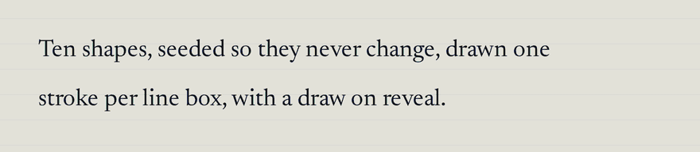
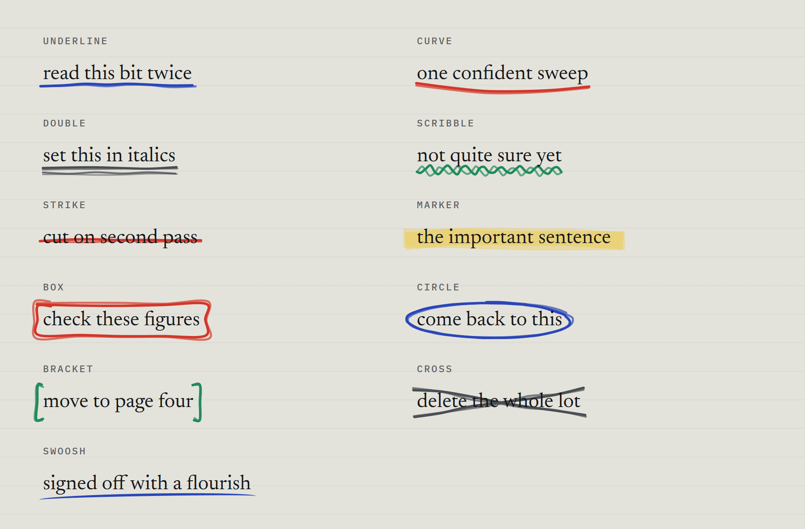
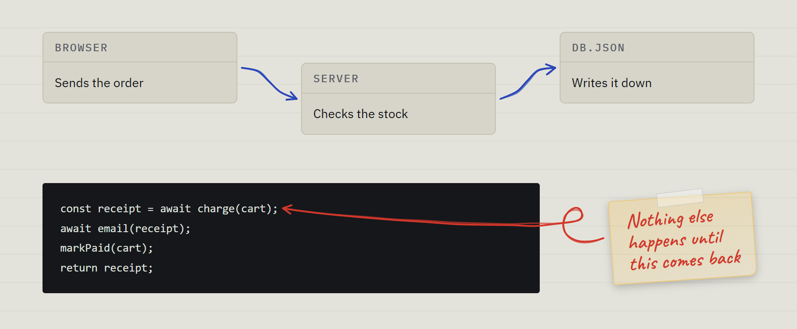
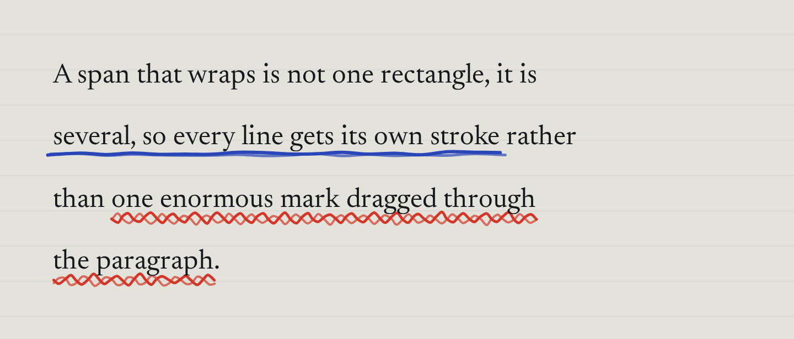

# Scrawl

Hand drawn annotation strokes for HTML text. Underlines, scribbles, circles, highlighter marks, and arrows from one thing to another: the wobbly pen-on-paper marks you see on a lot of marketing sites, without the site builder attached.

**[Live demo →](https://platima.github.io/scrawl/)**



Two builds, pick one:

| | `scrawl.js` | `scrawl.css` |
|---|---|---|
| Size | 20.6 KB minified, 7.9 KB gzipped, no deps | 19.8 KB, 2.7 KB gzipped, no deps |
| Shapes | 11 | 7 |
| Arrows between elements | Yes, `arrow` and `curl` | No |
| Per element wobble | Yes, seeded | No, every instance identical |
| Draw on animation | Yes | No |
| Runtime colour | Any CSS colour | 6 baked ink classes, plus a default |
| Wrapped text | Measured per line box | Free, backgrounds repeat per line |

There is also `scrawl-note.css`, a sticky note with a strip of tape, which works
with either build or neither. See [Sticky notes](#sticky-notes).

Demos: open `index.html` for the JS build, `css-only.html` for the stylesheet.

Both pull in sibling files, so open them from disk or serve the folder
(`python3 -m http.server`). Anywhere that sandboxes a single HTML file will
fail to resolve `scrawl.js` and throw `Scrawl is not defined`. For those cases
run `node build.js`, which inlines everything into `index.standalone.html` and
`css-only.standalone.html`.

## The JS build

```html
<script src="scrawl.js"></script>

<p>Kept the good bits, threw out
  <span data-scrawl="scribble" data-scrawl-color="#d2372a">the busy parts</span>.
</p>
```

That is it. It self initialises on DOM ready, scans for `[data-scrawl]`, and reveals each stroke when it scrolls into view. Set `window.SCRAWL_NO_AUTOINIT = true` before the script tag if you would rather call `Scrawl.init()` yourself.

No build step, no install. If you would rather not vendor the file, jsDelivr will serve it straight off this repo. Pin a tag rather than `main` so an update cannot change under you:

```html
<script src="https://cdn.jsdelivr.net/gh/platima/scrawl@v0.2.0/scrawl.min.js"></script>
```

Programmatic if you prefer:

```js
Scrawl.annotate('#headline', {
  type: 'circle',
  color: '#1f8a5b',
  thickness: 3,
  animate: true
}).show();
```

### Shapes

`underline` · `curve` · `double` · `scribble` · `strike` · `marker` · `box` · `circle` · `bracket` · `cross` · `swoosh`



`underline`, `curve`, `double`, `scribble`, `strike`, `marker` and `swoosh` draw one stroke per line box, so wrapped runs get a mark on every line. `box`, `circle`, `bracket` and `cross` use the union bounding box, because a circle around every line is not what anyone means.

`swoosh` is a single tapered mark under the text, full weight in the middle and thinning to a point at each end, with no wobble. It suits display type, where the pen shapes get scaled up until they look scratchy. `jitter` sets its tilt in degrees and `passes` is ignored.

### Arrows



```html
<div id="browser" data-scrawl="arrow" data-scrawl-to="#server">Browser</div>
<div id="server">Server</div>
```

`arrow` and `curl` join the element they are on to the one `data-scrawl-to` names, which takes a selector, or an element from JS:

```js
Scrawl.annotate('.scrawl-note', { type: 'curl', to: document.getElementById('slow-call') }).show();
```

The arrow leaves the middle of one element's facing side and lands square on the other's. Elements side by side join across the gap between them, elements stacked above and below join bottom to top, and when there is space both ways the wider gap wins, so the same markup routes sideways on a desktop layout and downwards once it stacks on a phone. It redraws when either end or the container holding them changes size. Two elements that overlap have no facing sides, so nothing is drawn.

The shaft is an S whose two bends sit halfway across the gap. `jitter` bows and wobbles it like the other shapes, and `jitter: 0` gives a clean curve. The head is drawn after the shaft arrives, angled to the line's last few px so it points true at the end of a curve.

`curl` is the same arrow with a small loop just after it sets off, for an aside rather than a diagram. It is made for a note in the margin pointing at a line of code or a phrase. The loop curls towards the side the target is on, scales with the line's thickness, and shrinks to fit when the ends are close.

An inline end that wraps onto several lines is joined at whichever line box sits nearest the other end. An empty span works as an end too, if you want to point at a spot rather than at a word.

The SVG goes in the nearest ancestor holding both ends, which gets `position: relative` if it was static. When the ends are far apart in the document that ancestor can be something big, even `<body>`, and making it relative moves anything absolutely positioned against an element further up. Name a closer container with `data-scrawl-within` if that bites. Arrows paint in front by default, because they usually end on something with a background of its own.

The routing, the head and the curl follow the diagrams [Mike Cann](https://github.com/mikecann) drew for [Build Your Own Convex](https://explained.convex.dev/build-your-own-convex/).



### Options

Every option works as a `data-scrawl-*` attribute or an object key.

| Attribute | Default | Does |
|---|---|---|
| `data-scrawl` | `underline` | Shape name, or `arrow` or `curl` |
| `data-scrawl-color` | inherited | Any CSS colour, falls back to the element's own text colour |
| `data-scrawl-thickness` | font size × 0.085, min 1.4px | Stroke width in px, written as a plain number. Scales with font size if left alone |
| `data-scrawl-passes` | `2` | How many times the pen goes over the whole figure. 1 is clean, 3 is scratchy |
| `data-scrawl-jitter` | `1` | 0 is ruler straight, above 1.5 gets messy fast |
| `data-scrawl-opacity` | `1` | Marker defaults to 0.32 so it does not bury the text |
| `data-scrawl-animate` | `true` | Draw-on reveal via IntersectionObserver |
| `data-scrawl-duration` | `650` | Milliseconds per stroke |
| `data-scrawl-delay` | `0` | Milliseconds before the first stroke, use it to sequence a paragraph |
| `data-scrawl-stagger` | `0.35` | Gap between strokes as a fraction of duration |
| `data-scrawl-direction` | `right` | Which end the pen starts from. Arrows always start from their own element |
| `data-scrawl-seed` | the text | Change it for a different wobble on the same words |
| `data-scrawl-front` | `false`, `true` for arrows | `true` paints over the glyphs instead of behind |
| `data-scrawl-repeat` | `false` | Redraw every time it scrolls back into view |
| `data-scrawl-threshold` | `0.2` | IntersectionObserver visibility trigger |
| `data-scrawl-respect-reduced-motion` | `true` | `false` draws even when the OS asks for reduced motion |
| `data-scrawl-to` | none | Arrows only. The element to point at, as a selector |
| `data-scrawl-head` | `end` | Arrows only. `end`, `start`, `both` or `none` |
| `data-scrawl-gap` | thickness × 2.5, min 4px | Arrows only. Px left clear between each end and its element |
| `data-scrawl-within` | nearest shared ancestor | Arrows only. Selector for the element the SVG goes in |

A number that does not parse is discarded rather than used, so a typo falls back to the default instead of drawing nothing.

### API

```js
Scrawl.annotate(elOrSelector, opts)  // returns an instance, call show() to reveal it
Scrawl.init(root)                    // scan for [data-scrawl], returns instances
Scrawl.refresh()                     // redraw everything, debounced to a frame
Scrawl.shapes                        // array of shape names
Scrawl.generators                    // add your own: Scrawl.generators.foo = fn
Scrawl.perLine                       // which shapes draw once per line box
Scrawl.connectors                    // which shapes join two elements
Scrawl.defaults                      // the defaults object, read once per annotation
Scrawl.instances                     // every annotation currently registered
Scrawl.version                       // which build you actually got, handy over a CDN
Scrawl.rng(numericSeed)              // the seeded mulberry32 factory
```

Instance methods: `show(animate)`, `hide()`, `refresh()`, `remove()`, `observe()`.

`show()` and `hide()` gate the reveal. With `animate: false`, or under reduced motion, there is no reveal to gate, so the stroke paints as soon as it renders and `hide()` takes the whole SVG down instead.

`Scrawl.defaults` is read when `annotate()` runs, so changing it only affects annotations made afterwards. `remove()` puts the parent's `position` and `isolation` back the way the first annotation found them, once no other annotation is still using that parent.

### How it works

The stroke is a real SVG appended to the annotated element's **parent**, positioned absolutely at `z-index: -1`. The parent gets `position: relative` and `isolation: isolate` if it did not have them. That keeps everything aligned through scrolling and nested scroll containers without any page coordinate maths, and the isolation stops the negative z-index escaping to the root stacking context and hiding behind an ancestor's background. If the annotated element itself has a background, or a later sibling paints over the stroke, use `data-scrawl-front="true"` instead. Arrows work the same way, except the SVG goes in the nearest ancestor holding both ends.

Each SVG is drawn in a padded space, so overshoot and circle sweep are never clipped, and then trimmed to the ink it actually holds. An empty padded box still counts towards the page's scroll width, and on a narrow phone layout that was enough to push the page sideways.

Rects come back in post-transform viewport pixels but the SVG's offsets are read in the parent's own space, so a scaled ancestor is divided back out before positioning. Rotation and skew are not corrected for.

Geometry is generated from a seeded PRNG (mulberry32), so a given bit of text always draws the same wobble across reloads. Points are jittered along the run, then smoothed with a Catmull-Rom to cubic bezier conversion, which turns a point cloud into something that reads as drawn rather than plotted. Drawing each shape twice by default is the other half of that.

Redraws are triggered by a `ResizeObserver` on the parent, `window.resize`, and `document.fonts.ready`, so a late web font does not leave the strokes stranded under the old metrics. Two things about that were worth getting right: `ResizeObserver.observe()` delivers a callback immediately, and redrawing on that first delivery tears down the SVG you have only just built, so it is skipped. And a redraw that lands mid reveal replays the animation rather than snapping it to the end.

The reveal uses the Web Animations API, not a CSS transition. A page level `* { transition: none }`, which a lot of resets and reduced motion blocks ship, silently kills a transition based reveal and leaves you looking at a finished stroke wondering what broke. `element.animate` ignores that. There is a transition fallback for anything without WAAPI.

`prefers-reduced-motion: reduce` paints the strokes immediately. Pass `respectReducedMotion: false` if you have a reason to override that, such as an explicit replay button the reader has just clicked.

Printing paints every stroke first, or anything the reader had not scrolled past would print blank. Paper also lays the text out again, so once the `print` media query matches, every annotation is measured again and redrawn for the page; Chrome still reports the screen's line boxes at `beforeprint`, which is too early. When printing ends, each annotation is measured on screen again and put back how it was, so one the reader has not reached yet still draws itself on when they get there. Firefox prints a static copy of the page without running script, so there it only gets the reveal.

### Writing your own shape

```js
Scrawl.generators.wave = function (rect, opts, rnd) {
  // rect is {x, y, w, h} in local SVG coords
  // opts has thickness, jitter, passes, color and friends
  // rnd is a seeded 0..1 function
  return [{ d: 'M...', w: opts.thickness, o: 1, cap: 'round' }];
};
```

Add the name to `Scrawl.shapes` if you want it in the demo picker. Shapes that should draw once per line rather than once per run need a flag in `Scrawl.perLine`, so `Scrawl.perLine.wave = 1`. Both maps are live, so a shape added at runtime works on the next redraw.

A shape that joins two elements gets a flag in `Scrawl.connectors` instead, and a fourth argument: the rect of the element named by `to`, in the same coordinates as the first. A stroke descriptor with `then: true` waits for the stroke before it to land rather than starting a stagger later, and `span` scales its duration, which is how an arrowhead follows its shaft:

```js
Scrawl.generators.zap = function (from, opts, rnd, to) {
  return [
    { d: 'M...', w: opts.thickness },                        // the shaft
    { d: 'M...', w: opts.thickness, then: true, span: 0.3 }  // a head, once the shaft arrives
  ];
};
Scrawl.connectors.zap = 1;
```

## The CSS build

```html
<link rel="stylesheet" href="scrawl.css">

<span class="scrawl scrawl--scribble scrawl--red">like this</span>
```

Shapes: `underline` · `double` · `scribble` · `strike` · `curve` · `marker` · `box`

Inks: `blue` · `red` · `yellow` · `green` · `lead` · `paper`. Leave the ink class off for near black.

Variables: `--scrawl-tile` (how often the wobble repeats), `--scrawl-height` (how tall the stroke band is), `--scrawl-drop` (lifts the stroke towards the baseline, go negative to push it lower). Shorthands: `.scrawl--thin`, `.scrawl--thick`, `.scrawl--tight`, `.scrawl--loose`, `.scrawl--low`.

Each variable only reaches a shape that reads it, so `marker` ignores height and drop, `curve` ignores tile, and `box` ignores all three because it draws with `border-image` rather than a background.

The stroke is an SVG `background-image`, so line wrapping is handled by the browser for free with no measuring, no listeners and no layout reads. `box-decoration-break: clone` gives each line fragment its own copy.

The one real limitation: a data URI cannot read a CSS custom property, so ink has to be baked into the SVG. That is why colours are classes rather than a variable. Adding your own means copying a rule and swapping its hex colour, remembering that `#` is written `%23` inside a data URI. Most shapes carry that colour in `stroke`; `marker` has no stroke and carries it in `fill`; `double` draws two strokes, so swap both or you get a two-tone rule. There is a worked example at the bottom of the stylesheet.

`box` uses `border-image` rather than a background so its corners hold their shape while the edges stretch. It comes out squarer than the JS version; if you want the properly wonky one, use the script.

Do not use `mask-image` for this, which is the obvious first approach: a mask clips the whole element including its text, not just the background.

## Sticky notes

```html
<link rel="stylesheet" href="scrawl-note.css">

<p class="scrawl-note">Nothing else happens until this comes back</p>
```

A translucent sticky note with one corner starting to lift and a strip of tape across the top, for a handwritten aside. It is plain CSS, so it works with either build or neither, and it pairs with `curl`: put `data-scrawl="curl"` on the note and point it at what it is about. The curl takes its colour from the note's text.

The element is the paper, padded around its text, so an arrow from it measures the note you can see. It shrinks to fit its text; position and width are up to you. Bring your own handwriting font. The demo uses Caveat.

| Property | Default | Does |
|---|---|---|
| `--scrawl-note` | `#f3b01c` | The paper's colour, mixed down to 20% so it reads as paper on a light page and on a dark one |
| `--scrawl-tape` | white at 35% | The tape |
| `--scrawl-tilt` | `-4deg` | How crooked it is stuck on. `.scrawl-note--level` sets it to 0 |

The paper is mixed with `color-mix()`, which needs a 2023 or later browser.

## Browser support

Anything with `IntersectionObserver` and `ResizeObserver`, so evergreen browsers. The script degrades to drawing immediately if `IntersectionObserver` is missing. The stylesheet needs `box-decoration-break`, which means the `-webkit-` prefix is included for Safari.

## Repo layout

```
scrawl.js       the library
scrawl.min.js   minified, generated
scrawl.css      the no-JS stylesheet
scrawl-note.css sticky notes, for either build
index.html      JS demo and playground
css-only.html   stylesheet demo
build.js        minifies the library, inlines it into single file demos
screenshots/    README images
```

`node build.js` regenerates `scrawl.min.js` and both standalone demos. Minifying
shells out to a pinned `terser` through `npx`, so there is nothing to install
first and the repo keeps no dependencies of its own; without a network it says
so and leaves the committed file alone rather than shipping a stale one.

`scrawl.min.js` is committed rather than ignored, because people CDN link it off
the repo. Rerun the build whenever `scrawl.js` changes. The `*.standalone.html`
files are gitignored, since they would go stale the moment you forgot.

## Thanks

[Mike Cann](https://github.com/mikecann) designed the arrows, the curl and the sticky note for [Build Your Own Convex](https://explained.convex.dev/build-your-own-convex/), which uses Scrawl for its pen marks, and contributed `swoosh`, the trimmed SVG boxes and the print fixes back.

## Licence

MIT, by [Platima](https://github.com/platima). Do what you like with it.
